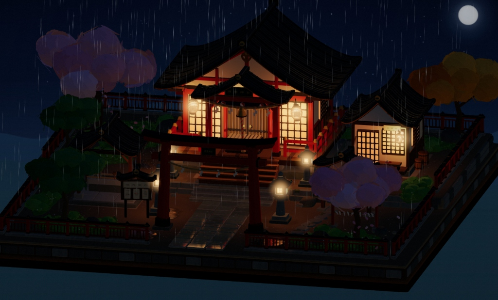

# 博丽神社 · 幻想乡的一隅

基于 Three.js 构建的博丽神社 3D 箱庭微缩场景。通过过程化几何体建模、自定义着色器与动态光影，还原博丽神社的晴雨与昼夜流转氛围，支持自由运镜和场景细节交互。

<p align="center">
  
  
</p>

## 特性实现

### 渲染与氛围系统
- **动态天色与光影流转**：基于太阳/月亮运行角度实时插值天空盒色彩与平行光朝向，支持白昼、夜晚固定视角与自然演进的昼夜循环（含晓色与暮色过渡）。
- **天气与材质交互**：集成雨天粒子与材质湿润状态机。降雨时地面石板与泥土自动切换菲涅尔反射水膜，伴随屋檐滴水动效与雨声采样。
- **夜间局部光源**：拜殿悬挂提灯、庭院石灯笼均具备带动态微弱呼吸效果的暖光衰减计算，并在夜晚自然唤醒场景中的萤火虫游走粒子。

### 场景与交互细节
- **运镜系统**：支持自由轨道控制器（左键旋转、滚轮缩放、右键平移），并提供案内板快捷聚焦机位（全景、鸟居参道、手水舍、拜殿正门、缘侧）。
- **角色状态机与对话互动**：
  - 白昼晴天时博丽灵梦在参道扫地，点击灵梦会摇响神乐铃并触发随机语音与台词气泡；
  - 夜晚晴天时伊吹萃香在社务所缘侧饮酒，点击萃香会碰响酒器并伴随微醺对话语音；
  - 触发降雨时角色自动回退至避雨状态。
- **微交互**：赛钱箱投币与铃铛摇动、绘马架摇签与纳签风铃轻响、手水舍流水声与水面波纹扰动、点击大鸟居弹出结界注解。

## 本地运行

本仓库为开箱即用的静态发行包，不含 Node 编译依赖。因浏览器同源策略限制本地异步静态资源（Audio / Image）加载，需通过任意静态 Web 服务启动：

```bash
# Python
python -m http.server 8080

# 或使用 Node / npx
npx serve .
```

启动后在浏览器访问 `http://localhost:8080` 即可。

## 文件结构

- `index.html`：项目入口，内嵌轻量加载屏
- `assets/shrine-core-*.js`：Three.js 核心引擎、场景构建、着色器与交互逻辑
- `assets/audio-pack-*.js`：环境音效与交互语音资源包（首次操作后按需懒加载）
- `assets/rain-field-*.mp3`：真实环境降雨录音音频
- `assets/suika/*.webp`：角色动作序列帧图集
- `*.gz`：对应静态资源的 Gzip 预压缩版本（可供 Web 服务器配合 `gzip_static` 使用）

## 鸣谢与致谢 (Credits)

- **场景原型与代码实现**：本项目基于原作者 **ling99LL（B站：[INI蜜柑](https://space.bilibili.com/32913296)）** 的开源项目 [ling99LL/hakurei-shrine](https://github.com/ling99LL/hakurei-shrine)（演示视频 [BV1KcbL6fEkH](https://www.bilibili.com/video/BV1KcbL6fEkH)）进行二次开发与重构。
- **降雨环境音采样**：来自 [Wikimedia Commons (ezwa / PDSounds)](https://commons.wikimedia.org/wiki/File:Rain_(1).ogg)（Public Domain）。

---

*东方 Project 原作版权归上海爱丽丝幻乐团（ZUN）所有，本项目为个人非商业性质的同人技术展示作品。*
